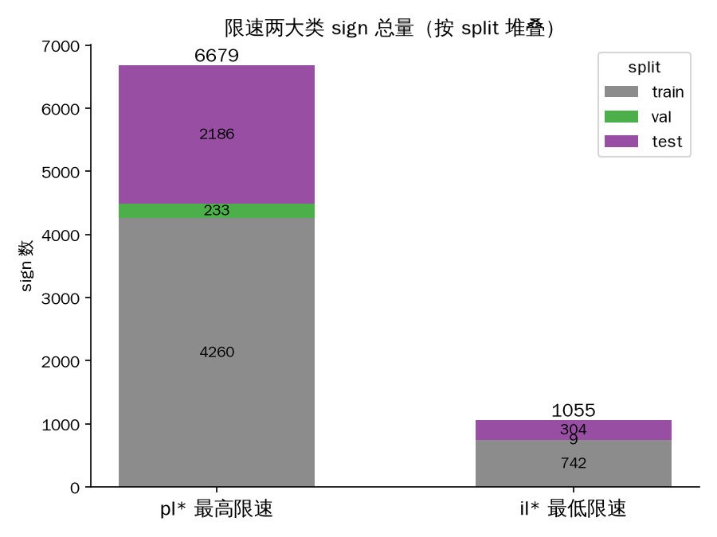
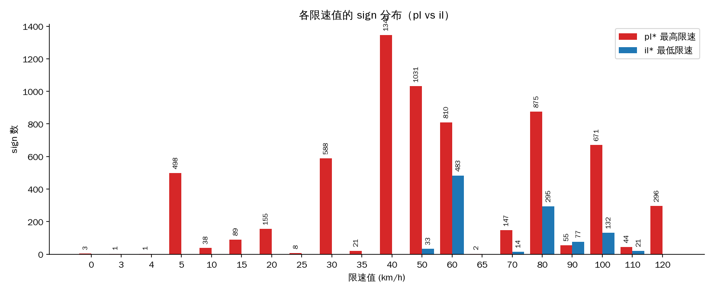
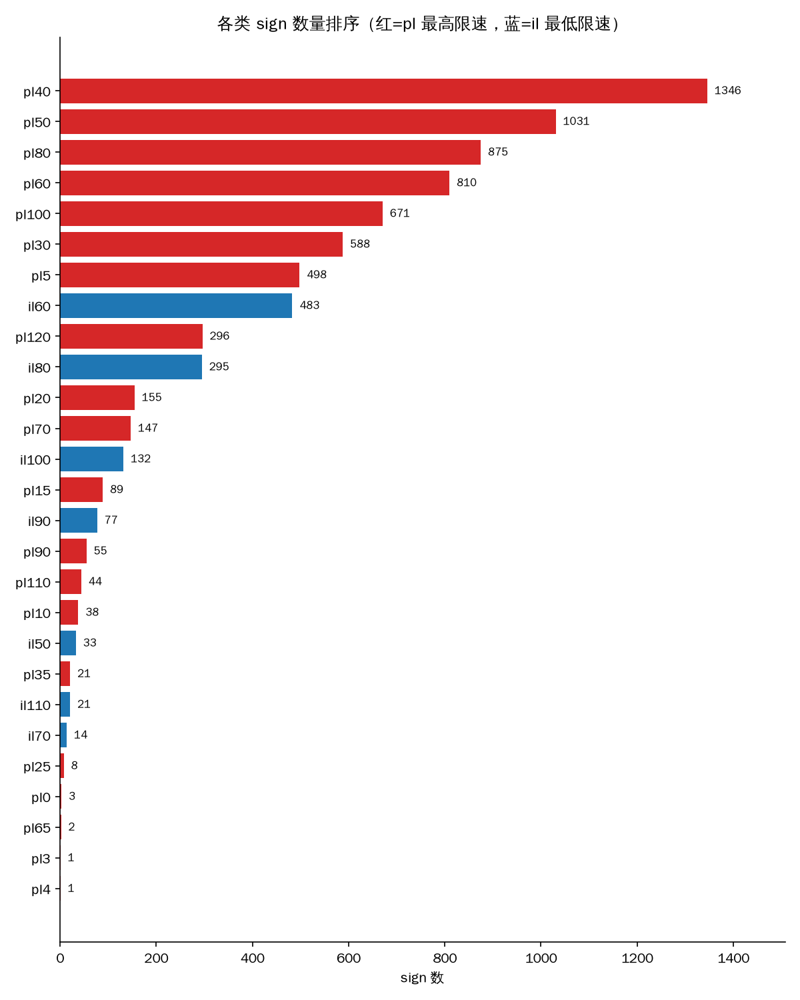

# 限速类别分布报告（pl 最高限速 vs il 最低限速）

生成时间：2026-09-23T02:31:20.072058+00:00；数据：`data/TT100K_speed_crops/manifest.csv`（scale=1.0，**7734 signs**；crops 为其 4× scale 展开，不重复计数）

## 1. 两大类总量

| 类别 | sign 数 | 占比 | 类数 | P50 短边 px |
|------|--------:|-----:|-----:|------------:|
| pl* 最高限速 | 6679 | 86.4% | 20 | 36 |
| il* 最低限速 | 1055 | 13.6% | 7 | 43 |
| 合计 | 7734 | 100% | 27 | — |

**要点**：pl:il ≈ 6.3:1，最高限速占绝对主导；最低限速（高速公路场景）样本不到 14%，且尺寸中位数更大（近距离拍摄、清晰度更好）。

## 2. 各限速值分布

| 限速值 (km/h) | pl sign 数 | il sign 数 |
|--------------|-----------:|-----------:|
| 0 | 3 | 0 |
| 3 | 1 | 0 |
| 4 | 1 | 0 |
| 5 | 498 | 0 |
| 10 | 38 | 0 |
| 15 | 89 | 0 |
| 20 | 155 | 0 |
| 25 | 8 | 0 |
| 30 | 588 | 0 |
| 35 | 21 | 0 |
| 40 | 1346 | 0 |
| 50 | 1031 | 33 |
| 60 | 810 | 483 |
| 65 | 2 | 0 |
| 70 | 147 | 14 |
| 80 | 875 | 295 |
| 90 | 55 | 77 |
| 100 | 671 | 132 |
| 110 | 44 | 21 |
| 120 | 296 | 0 |

**要点**：
- pl 头部值集中在 40/50/80 km/h（top3 占 pl 的 49%），与中国城市/快速路主流限速一致；40 为绝对峰值（1346 sign）。
- il 值域窄（50–110），峰值 60 km/h，符合高速最低限速场景。
- il 与 pl 数值有交集（50/60/70/80/90/100/110），但外观差异大（蓝底 vs 白底红圈），分类器应能靠颜色特征区分组别。
- 罕见值（pl0/pl3/pl4/pl25/pl35/pl65 等）样本极少，长尾严重。

## 3. 每类明细（按 split）

| 类 | 组 | train | val | test | 合计 |
|----|----|------:|-----:|-----:|-----:|
| pl40 | pl | 874 | 27 | 445 | 1346 |
| pl50 | pl | 660 | 31 | 340 | 1031 |
| pl80 | pl | 578 | 23 | 274 | 875 |
| pl60 | pl | 526 | 10 | 274 | 810 |
| pl100 | pl | 449 | 6 | 216 | 671 |
| pl30 | pl | 373 | 10 | 205 | 588 |
| pl5 | pl | 269 | 26 | 203 | 498 |
| il60 | il | 338 | 5 | 140 | 483 |
| pl120 | pl | 208 | 1 | 87 | 296 |
| il80 | il | 197 | 2 | 96 | 295 |
| pl20 | pl | 98 | 1 | 56 | 155 |
| pl70 | pl | 103 | 0 | 44 | 147 |
| il100 | il | 92 | 1 | 39 | 132 |
| pl15 | pl | 31 | 41 | 17 | 89 |
| il90 | il | 59 | 1 | 17 | 77 |
| pl90 | pl | 42 | 10 | 3 | 55 |
| pl110 | pl | 26 | 13 | 5 | 44 |
| pl10 | pl | 14 | 11 | 13 | 38 |
| il50 | il | 28 | 0 | 5 | 33 |
| il110 | il | 19 | 0 | 2 | 21 |
| pl35 | pl | 3 | 17 | 1 | 21 |
| il70 | il | 9 | 0 | 5 | 14 |
| pl25 | pl | 5 | 1 | 2 | 8 |
| pl0 | pl | 1 | 2 | 0 | 3 |
| pl65 | pl | 0 | 2 | 0 | 2 |
| pl4 | pl | 0 | 1 | 0 | 1 |
| pl3 | pl | 0 | 0 | 1 | 1 |

## 4. 长尾与不平衡（训练注意事项）

- **sign 数 < 50 的稀有类：11 个** —— `pl4`(1)、`pl3`(1)、`pl65`(2)、`pl0`(3)、`pl25`(8)、`il70`(14)、`il110`(21)、`pl35`(21)、`il50`(33)、`pl10`(38)、`pl110`(44)
- il70（14）、il110（21）、il50（33）等最低限速类极少；建议分类阶段合并到「速度值 + 组别」层面（如 il 类仅 7 个值），或训练时 domain/class-balanced sampling。
- val split 总量太小（242 sign），分类验证应以 train/test 互补评估（见 `reports/crop_stats.md` 风险提示）。
- **split 不均**：个别稀有类 sign 集中在 val 而非 train（pl15: 31/41/17、pl35: 3/17/1，按 train/val/test）——若按类做 train 映射需留意其 val 样本无法参与训练。
- pl0/pl3/pl4 语义存疑（0/3/4 km/h 不在 GB 标准值域），样本仅 1–3 个，建议训练时并入相邻类或作为 other 处理（不动原始标签，仅训练映射层处理）。
